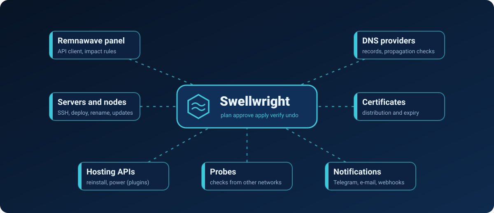

<div align="center">



<br>

[](docs/en/roadmap.md)
[](https://github.com/swellwright/swellwright/actions/workflows/ci.yml)
[](LICENSE)
[](https://docs.rw)
[](docs/en/api.md)
[](docs/en/architecture.md)
[](deploy/compose/docker-compose.yml)
[](CONTRIBUTING.md)
[](CONTRIBUTING.md)
[](https://github.com/swellwright/swellwright/stargazers)
[](https://github.com/swellwright/swellwright/commits/main)

<a href="docs/en/index.md"></a>
<a href="docs/en/roadmap.md"></a>
<a href="docs/en/plugins.md"></a>
<a href="docs/en/security.md"></a>
<a href="README.ru.md"></a>

</div>

<br>

> [!WARNING]
> **Pre-alpha, phases 1–3 implemented.** The console, security foundation, inventory/SSH and read-only panel integration are implemented. The general workflow engine and full deploy/rollback flows are still planned. See [current status](docs/en/project-status.md) and [development setup](docs/en/development.md); interfaces may change before the first release.

> [!NOTE]
> Swellwright is an independent community project. It is **not affiliated with or endorsed by Remnawave**.

## Why

Running a [Remnawave](https://docs.rw) fleet means repeating the same careful, risky procedures by hand: building a node, reinstalling one, renaming it (host, nginx, HAProxy, DNS, panel objects), rotating keys, updating images, checking drift, rolling back a change that went wrong.

Swellwright turns each of them into a **plan, approve, apply, verify, roll back** workflow, with a journal, live progress and a complete undo, from one web console and one OpenAPI.

<p align="center">
  <br>
  
</p>

## Highlights

<table>
<tr>
<td width="50%" valign="top">

### 🧭 Plan before touching anything
Every workflow starts with a read-only dry run: what changes, what restarts (for example "this edit restarts N nodes"), what the undo looks like. Approvals are bound to a hash of the plan.

</td>
<td width="50%" valign="top">

### ♻️ Durable runs, full undo
Run state lives in PostgreSQL. Steps on a node are detached processes that survive SSH drops; a killed worker is resumed by another one. Every change records how to reverse it.

</td>
</tr>
<tr>
<td valign="top">

### 🔌 Deep Remnawave integration
A typed client for every panel operation, a convention linter, an impact calculator, config snapshots and diff, a hop-chain builder, subscription template and rule rollouts, scoped token management.

</td>
<td valign="top">

### 🔐 Vault and honest SSH
Envelope encryption, sealed on start. SSH by password, key or certificate, your choice per server. The web terminal never injects stored secrets: **you type the real credentials for each session**.

</td>
</tr>
<tr>
<td valign="top">

### 🧩 Plugins for everything specific
DNS and hosting providers, certificate distribution, notification channels, login providers, node flavors and client compatibility packs. Declarative drivers need no code; community plugins run as isolated container sidecars.

</td>
<td valign="top">

### 📡 Probes and monitoring
Probe agents on machines in other networks, time-of-day availability matrices, alerts and an incident log. Recommendations are advisory and never applied automatically.

</td>
</tr>
</table>

<details>
<summary><b>Scenario families (87 scenarios)</b></summary>

- **Servers and nodes:** adopt, add, deploy, redeploy, rename with finalize, decommission, replace a blocked node, change IP, move between profiles, update image or Xray, OS and kernel updates, reboot cycles, hardening baseline and drift repair, API-port ACL, firewall and fail2ban, SSH access and key rotation, certificates, decoy site and proxy configs, ad-hoc commands, files, web terminal, incident playbooks.
- **Remnawave objects:** panel connection and tokens, config profiles (editor, linter, impact calculator), REALITY key rotation, hosts and convention linter, squads, subscription templates and rules, hop chains (including multi-hop), plugins and snippets, infrastructure billing, panel backups and restore tests, snapshots and GitOps export, audit, API console.
- **DNS:** provider drivers, record lifecycle with propagation checks on authoritative servers, TTL strategy, naming convention engine.
- **Security:** vault, login (password, TOTP, passkeys, OIDC), roles and tokens, optional SSH certificate authority, tamper-evident audit, output redaction, supply-chain controls, incident wizards.
- **Monitoring:** TCP, TLS with SNI, VLESS through a test user, data-freeze test, mtr; time-of-day matrix; alerts and incident log.
- **Platform:** CLI, OpenAPI SDKs, MCP server, signed webhooks, import and export, schedules and maintenance windows, reports, i18n, self-backup, plugin system.

</details>

## Design principles

1. **Read-only by default.** Every change goes plan → approve → apply → verify → roll back.
2. **Reversible or explicitly irreversible,** with an undo record and a pre-change snapshot.
3. **The fleet is autonomous.** Nodes keep working without Swellwright; a break-glass path always exists.
4. **Universal core, specific plugins.** Anything tied to one provider, vendor or naming scheme is a plugin or an example.
5. **Secrets stay secret.** Vault, redaction everywhere, nothing printed, nothing logged.
6. **Facts and hypotheses are labelled** (measured, community-reported, assumption).

The full list is in the [overview](docs/en/index.md#principles).

## Stack

The same stack as the Remnawave panel, so the UI feels familiar and contributors can work on both:

| Layer | Choice |
|---|---|
| Backend | NestJS, TypeScript, Zod, BullMQ on Valkey |
| Data | PostgreSQL with Prisma |
| SSH | `ssh2` (pooling, detached steps, sudo, PTY, SFTP, certificates) |
| Frontend | React, Vite, Mantine, TanStack Query, xterm.js |
| API | OpenAPI 3.1 generated from Zod, Scalar docs, generated SDK and CLI |
| Packaging | Docker and Compose, monorepo with pnpm and Turborepo |

Details: [architecture](docs/en/architecture.md).

## Documentation

| | |
|---|---|
| [Overview](docs/en/index.md) | goals, non-goals, principles, scenario families |
| [Architecture](docs/en/architecture.md) | components, execution model, SSH layer, topologies |
| [Remnawave integration](docs/en/remnawave-integration.md) | tokens and scopes, impact rules, conventions |
| [Plugins](docs/en/plugins.md) | extension points, manifest, trust levels |
| [Security](docs/en/security.md) | threat model, vault, access methods, terminal, audit |
| [API](docs/en/api.md) | OpenAPI conventions, resource groups, events |
| [Roadmap](docs/en/roadmap.md) | phases and acceptance criteria |
| [Design documents](docs/en/design/00-index.md) | the complete design: data model, scenario catalog, engine, testing, risks |
| [Decisions](docs/adr/) | architecture decision records |
| [Русская документация](docs/ru/README.md) | full design set in Russian |

## Repository layout

```text
apps/              api, worker, web, cli, probe-agent
packages/          contracts, engine, steps, remnawave client, ssh, vault, policy, plugin-api, ui, testing
plugins/official/  DNS, login, notification, hosting, node-flavor and client-pack plugins
examples/          conventions, policies, templates, hop-chain presets, declarative drivers
registry/          community plugin registry index
deploy/            compose and reverse-proxy examples
artifacts/         files shipped to servers and verified by hash: the node installer (script, manifest, tests)
scripts/           repository hygiene checks, the artifact manifest tool
assets/            logo, favicon and banners
docs/              en (canonical), ru, adr
```

## Contributing and security

- Contributions are welcome under the [Developer Certificate of Origin](DCO): sign off your commits with `git commit -s`. Start with [CONTRIBUTING.md](CONTRIBUTING.md).
- Questions and ideas: see [SUPPORT.md](.github/SUPPORT.md).
- Report vulnerabilities privately, see [SECURITY.md](SECURITY.md). Never put real credentials, IP addresses or domains of a real deployment in issues, pull requests or tests.

## License

[AGPL-3.0-only](LICENSE). If you run a modified version as a network service you must offer its source to your users.
