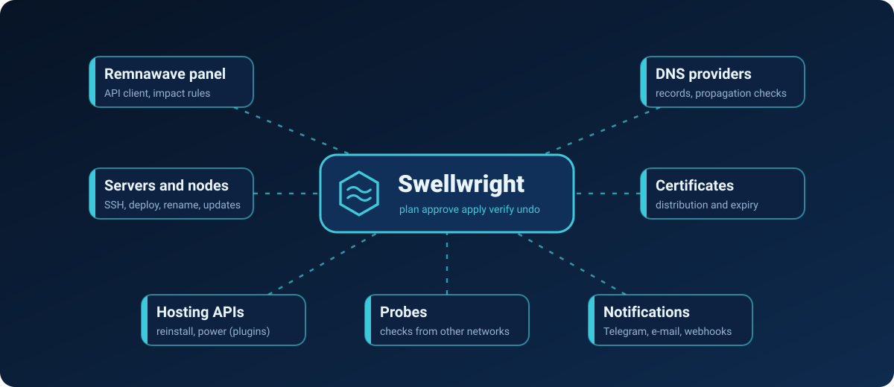

 

 

> [!WARNING]
> **Pre-alpha, фазы 1–3 реализованы.** Есть консоль, безопасность, инвентарь/SSH и интеграция с панелью на чтение. Общий движок workflow и полные сценарии развёртывания/отката ещё запланированы. См. [состояние проекта](docs/ru/project-status.md) и [работу с агентами](docs/ru/development.md); интерфейсы могут меняться до первого релиза.

> [!NOTE]
> Swellwright это независимый проект сообщества. Он **не связан с Remnawave и не одобрен его авторами**.

## Зачем

Сопровождение парка [Remnawave](https://docs.rw) это повторение одних и тех же осторожных и рискованных операций вручную: собрать ноду, переустановить, переименовать (хост, nginx, HAProxy, DNS, объекты панели), сменить ключи, обновить образы, проверить дрейф, откатить неудачное изменение.

Swellwright превращает каждую из них в сценарий **план → согласование → применение → проверка → откат** с журналом, живым прогрессом и полным откатом: из одной веб-консоли и одного OpenAPI.

   
  

## Возможности

<table>
<tr>
<td width="50%" valign="top">

### 🧭 План до любых действий
Каждый сценарий начинается с сухого прогона только на чтение: что изменится, что перезапустится (например «эта правка перезапустит N нод»), как выглядит откат. Согласование привязано к хешу плана.

</td>
<td width="50%" valign="top">

### ♻️ Долговечные запуски и полный откат
Состояние запуска хранится в PostgreSQL. Шаги на ноде выполняются отдельными процессами и переживают обрыв SSH; упавший воркер подхватывает другой. Каждое изменение записывает, как его отменить.

</td>
</tr>
<tr>
<td valign="top">

### 🔌 Глубокая интеграция с Remnawave
Типизированный клиент всех операций панели, линтер конвенций, калькулятор влияния, снимки и дифф конфигурации, конструктор хоп-цепочек, раскатка шаблонов и правил подписки, управление токенами.

</td>
<td valign="top">

### 🔐 Хранилище и честный SSH
Конвертное шифрование, запечатывание при старте. SSH по паролю, ключу или сертификату, на выбор для каждого сервера. Веб-терминал никогда не подставляет сохранённые секреты: **реальные данные для входа вы вводите на каждую сессию**.

</td>
</tr>
<tr>
<td valign="top">

### 🧩 Плагины для всего специфичного
Провайдеры DNS и хостинга, распространение сертификатов, каналы уведомлений, способы входа, варианты узла и пакеты совместимости клиентов. Декларативные драйверы не требуют кода; чужие плагины работают как изолированные контейнеры.

</td>
<td valign="top">

### 📡 Зонды и мониторинг
Агенты проверок на машинах в разных сетях, матрицы доступности по времени суток, оповещения и журнал инцидентов. Рекомендации только советуют и никогда не применяются автоматически.

</td>
</tr>
</table>

## Принципы

1. **По умолчанию только чтение.** Любое изменение проходит план → согласование → применение → проверка → откат.
2. **Обратимо или явно помечено необратимым,** с записью отката и снимком до изменения.
3. **Парк автономен.** Ноды работают без Swellwright; аварийный доступ остаётся всегда.
4. **Универсальное ядро, специфика в плагинах.** Всё, что привязано к одному провайдеру, вендору или схеме имён, это плагин или пример.
5. **Секреты остаются секретами.** Хранилище, маскирование везде, ничего не печатается и не попадает в журналы.
6. **Факты и гипотезы различаются** (измерено, сообщество, предположение).

## Стек

Тот же стек, что у панели Remnawave: интерфейс знаком, а участники могут работать над обоими проектами.

| Слой | Выбор |
|---|---|
| Бэкенд | NestJS, TypeScript, Zod, BullMQ на Valkey |
| Данные | PostgreSQL, Prisma |
| SSH | `ssh2` (пул, шаги отдельным процессом, sudo, PTY, SFTP, сертификаты) |
| Фронтенд | React, Vite, Mantine, TanStack Query, xterm.js |
| API | OpenAPI 3.1 из Zod, документация Scalar, генерируемые SDK и CLI |
| Поставка | Docker и Compose, монорепозиторий на pnpm и Turborepo |

## Документация

| | |
|---|---|
| [Проектные документы (русский)](docs/ru/design/00-index.md) | полный набор: архитектура, модель данных, сценарии, безопасность, API, интерфейс, движок, тесты, дорожная карта, плагины |
| [Проектные документы (английский перевод)](docs/en/design/00-index.md) | тот же набор на английском |
| [English overview](docs/en/index.md) | цели, принципы, семейства сценариев |
| [Architecture](docs/en/architecture.md) | компоненты, модель выполнения, SSH-слой |
| [Security](docs/en/security.md) | модель угроз, хранилище, терминал, аудит |
| [Plugins](docs/en/plugins.md) | точки расширения, манифест, уровни доверия |
| [Решения](docs/adr/) | записи об архитектурных решениях |

## Участие и безопасность

- Вклад принимается по [Developer Certificate of Origin](DCO): подписывайте коммиты (`git commit -s`). Начните с [CONTRIBUTING.md](CONTRIBUTING.md).
- Вопросы и идеи: [SUPPORT.md](.github/SUPPORT.md).
- Об уязвимостях сообщайте приватно, см. [SECURITY.md](SECURITY.md). Не публикуйте реальные пароли, IP-адреса и домены настоящих установок в задачах, запросах на слияние и тестах.

## Лицензия

[AGPL-3.0-only](LICENSE). Если вы запускаете изменённую версию как сетевой сервис, вы обязаны предложить её исходный код своим пользователям.
