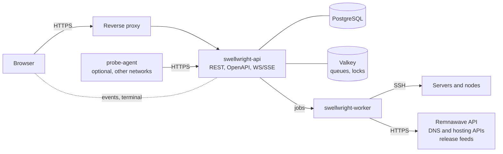
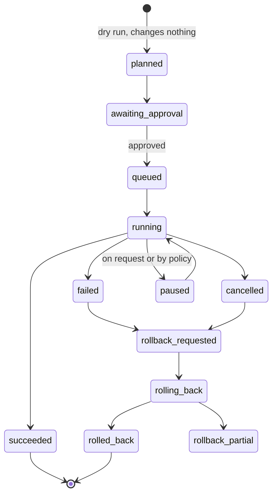

# Architecture

This page includes the target architecture. See [project status](project-status.md) for implemented features; the general worker/engine and full workflow lifecycle remain planned.

## Stack (aligned with Remnawave 3.4.x)

| Layer | Choice |
|---|---|
| Backend | NestJS 12 (the panel uses 11), TypeScript 6.0 (the panel uses 5.9, see ADR 0009), Zod 4 (route registry, ADR 0012), CQRS, `@nestjs/schedule`, Terminus, Prometheus |
| Database | PostgreSQL with Prisma 7 (ADR 0013) and Kysely for heavy queries |
| Queues and locks | BullMQ on a Redis-compatible store (Valkey); Redlock and PostgreSQL advisory locks |
| SSH | `ssh2`: pooling, detached steps, sudo, PTY terminal, SFTP, certificates |
| Panel client | `@remnawave/backend-contract` pinned per panel version |
| Frontend | React 19, Vite, Mantine 9, TanStack Query 5, Zustand 5, React Router 7, Zod 4, i18next, Tabler icons, Monaco, xterm.js |
| API docs | OpenAPI 3.1 generated from the route registry (ADR 0012), Scalar UI |
| Monorepo | pnpm workspaces, Turborepo, strict TypeScript and ESLint, `--frozen-lockfile --ignore-scripts` |

## Components

- **api**: REST and OpenAPI, WebSocket/SSE, serves the UI, authentication and authorization, enqueues runs.
- **worker**: executes workflows (SSH, panel and DNS calls, probes); stateless, can be scaled out.
- **web**: static UI bundled into the api image.
- **probe-agent** (optional): outbound HTTPS only, write-only token.
- **cli** and **mcp** (optional) on top of the same API.

## Execution model

A run is a database record plus a queue job. A worker takes locks on resources (node, server, DNS zone, panel, panel host) and executes stages. After every step a checkpoint (step state, undo records, outputs without secrets) is written. If a worker dies, another one resumes from the last unfinished step; a step already running on a node is **re-attached** by reading its log and exit-code file.

Approval gates pause a run until a human decides; the decision is bound to a hash of the plan.

## SSH layer

- Host keys are pinned (explicit confirmation on first use, alert on change).
- Access methods are configurable per server or group: password, key or certificate.
- Node-side steps run with `setsid`, writing a log and an exit-code file under `<baseDir>/<id>/` (ADR 0035); the screen follows the log by polling, so a dropped session does not kill `apt` or `docker`.
- `sudo` passwords go through stdin, never through command lines.
- Terminal: PTY sessions with credentials typed by the user for that session only.

## Node-side artifacts

A POSIX `sh` installer (versioned, in `artifacts/node-installer/`, ADR 0036) and a small Python engine for snapshot, undo plan, undo and a safety timer for SSH and firewall changes. They are uploaded as versioned artifacts with hash verification; nothing is installed permanently on the node except what the workflow installs.

## Deployment topologies

1. **A separate small VM** (recommended): the compose stack from `deploy/compose`.
2. **On the panel server** in an isolated Docker network: own PostgreSQL and Valkey, unprivileged user, resource limits, egress firewall, no `docker.sock`, no direct access to the panel database.
3. A runner in another network for tasks that need a specific network path (optional).
4. An outbound-only node agent for servers without reachable SSH (optional, later).

## Why TypeScript

One stack with the panel (typed contracts, shared Zod schemas across API, UI and CLI), durable execution and events in one runtime, and end-to-end golden scenario tests that pin the observable behavior of every workflow. The node-side parts stay `sh` and Python because nodes need POSIX `sh` and minimal dependencies.
